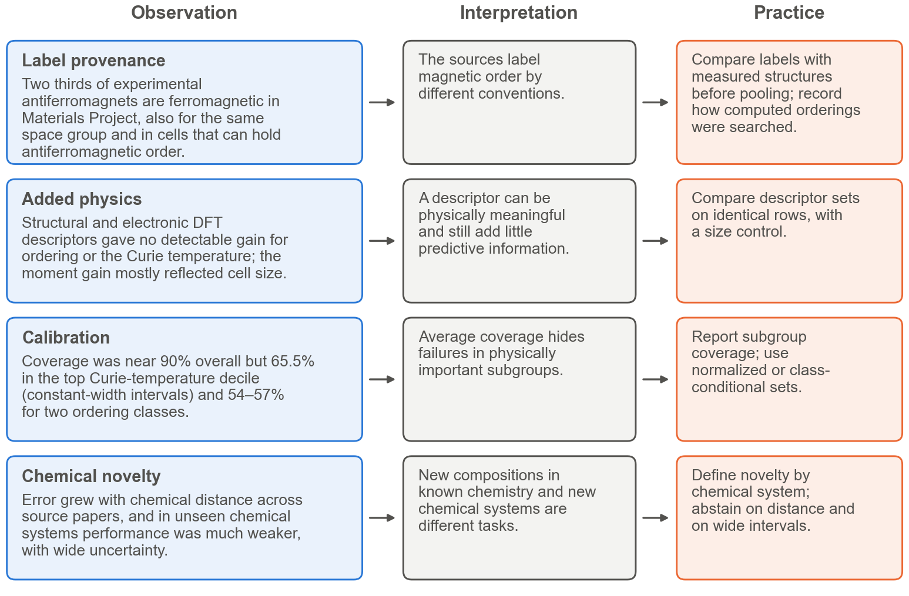

# Reliable machine learning of magnetic materials needs more than accuracy

Data, code, results and manuscript for the paper of the same title, prepared for *Nature Communications*.

**[Read the manuscript (PDF)](manuscript/manuscript.pdf)** · **[Supplementary Information (PDF)](manuscript/supplementary.pdf)** ·
[Results by research question](results/README.md) · [How to reproduce](scripts/README.md)

---

## In one paragraph

Machine-learning models of magnetic materials are usually judged by their accuracy on held-out data from their own training sources.
We asked whether their predictions remain meaningful once four conditions are examined: what the labels represent, what physical
descriptors add, whether uncertainty holds across subgroups, and how far a material lies from the training chemistry. On one curated dataset of magnetic ordering, Curie temperature
and the computed magnetic moment, with matched descriptor comparisons, conformal uncertainty and an audited external benchmark, each
condition turned out to limit what a reported accuracy means.

## Main findings

| | Finding | Key numbers |
|---|---|---|
| **1** | **Computed and experimental labels describe magnetic order differently.** Two thirds of experimentally antiferromagnetic compounds are ferromagnetic in Materials Project, also for the same space group; measured magnetic structures (MAGNDATA) side with the experimental labels. | agreement 28%, κ = 0.00 (949 formulas); phase-matched 25%, κ = 0.01 (330); vs MAGNDATA: experimental 92%, Materials Project 22% |
| **2** | **Structural and electronic DFT descriptors add little beyond composition.** No detectable gain for ordering or Curie temperature on identical materials and splits; the small gain for the moment reflects cell size. | moment gain +0.079 μB/cell (+0.030 to +0.127), 3–4% of the error, about 70% recovered by one site-count descriptor |
| **3** | **Marginal calibration conceals material-dependent failures.** Prediction sets that are calibrated on average miss antiferromagnets and ferrimagnets; class-conditional sets repair this. | marginal sets cover AFM 57%, FiM 54%; class-conditional ≈ 90% for every class |
| **4** | **Reliability decays with chemical novelty.** On an external benchmark whose apparent independence was mostly overlap, error grows with chemical distance, and unseen chemical systems are much weaker, with wide uncertainty. | blind records: MAE 103 K, R² 0.69 (465); unseen systems: R² −0.17 [−1.02, 0.64] (69); ρ(distance, error) = 0.28 |
| **5** | **Selective prediction supports first-stage screening.** Abstaining on wide intervals keeps the decisions that are made reliable. | interval decisions at a 300 K threshold 92.5–97.6% accurate |

<p align="center">
  
  <br><em>Fig. 6 of the manuscript: what was observed, what it means and what follows.</em>
</p>

## Repository layout

```
.
├── manuscript/      the paper: LaTeX sources, PDFs, figures and their builders          → manuscript/README.md
├── results/         every saved result behind a number in the paper, by research question → results/README.md
├── data/            frozen analysis datasets (v1.2–v1.4), splits and reference inputs     → data/README.md
├── scripts/         analysis pipeline, tests, workspace and checksum tools                → scripts/README.md
└── CHECKSUMS.sha256 SHA-256 of every file in data/ and results/
```

| Research question | Results folder | In the paper |
|---|---|---|
| Do physical descriptors improve prediction? | [`results/rq1_physics_descriptors/`](results/rq1_physics_descriptors) | Results 2, Fig. 2, Table 2 |
| Are the predictions calibrated? | [`results/rq2_uncertainty/`](results/rq2_uncertainty) | Results 3, Fig. 3 |
| Do the predictions generalize? | [`results/rq3_generalization/`](results/rq3_generalization) | Results 4, Fig. 4, Table 3 |
| Label provenance, screening and the checks added in review | [`results/revision/`](results/revision) | Results 1 and 5, Figs 1 and 5, Supplementary Tables |

## Quick start

```bash
pip install -r scripts/requirements.txt     # Python 3.12
python scripts/verify_checksums.py           # all data and result files intact
cd manuscript
python make_figures.py                       # figures from the saved results (seconds)
python build.py                              # PDFs (needs tectonic)
```

Re-running the analyses themselves (hours) is described step by step in [`scripts/README.md`](scripts/README.md): a workspace is created
with `scripts/setup_workspace.py`, and every step names the result file to compare against.

## Verification

- `scripts/verify_checksums.py`: all 453 data and result files match `CHECKSUMS.sha256`.
- In a fresh workspace from `scripts/setup_workspace.py`, the analysis tests (62) and the external-benchmark audit tests (11) pass.
- `manuscript/make_figures.py` redraws every figure from `results/`; the manuscript, Supplementary Information and review copy compile
  without overfull boxes or undefined references.
- Seeds are fixed in `scripts/pipeline/config/`. XGBoost results also depend on the thread count, which acts like a random seed;
  leave `OMP_NUM_THREADS` unset (16 threads were used). Claims are stated across repeated splits, not single fits.

## Data sources and licences

| Source | Terms | In this repository |
|---|---|---|
| Materials Project, OQMD, JARVIS-DFT | CC BY 4.0 | derived values |
| ChemDataExtractor Curie/Néel database (Kelly & Cole 2025) | CC BY 4.0 | derived values |
| NEMAD classification sets (Zenodo release) | CC BY 4.0 | derived values |
| NEMAD literature tables (nemad.org) | research use, **no redistribution** | values included because this repository is private; redact with `--redact-nemad` before any public release ([details](data/README.md#nemad-literature-tables-private-repository)) |
| MAGNDATA (Bilbao Crystallographic Server) | usage conditions of the server | derived labels with the requested citations; no structure files |
| AFLOW | non-commercial use | collected but not used; no AFLOW values in this repository |
| External Curie benchmark (malaei/Magnetic_data) | no licence stated | the table itself is not included (`scripts/fetch_external_benchmark.py` downloads it, SHA-256 checked); three result files in `results/rq3_generalization/external_benchmark/` hold its compound names and values |

The quoted terms of every source are in [`results/revision/research/data_licences.md`](results/revision/research/data_licences.md).
Users of NEMAD-derived material must cite Itani, Zhang & Zang, *Nat. Commun.* **16**, 9415 (2025) and Zhang *et al.*,
*J. Magn. Magn. Mater.* **597**, 172001 (2024). No credentials are included; the one script that queries Materials Project reads
`MP_API_KEY` from the environment.

## Citation and licence

Citation details will be added when the paper is published. A licence for the code will be added with the publication; until then the
default copyright applies.
